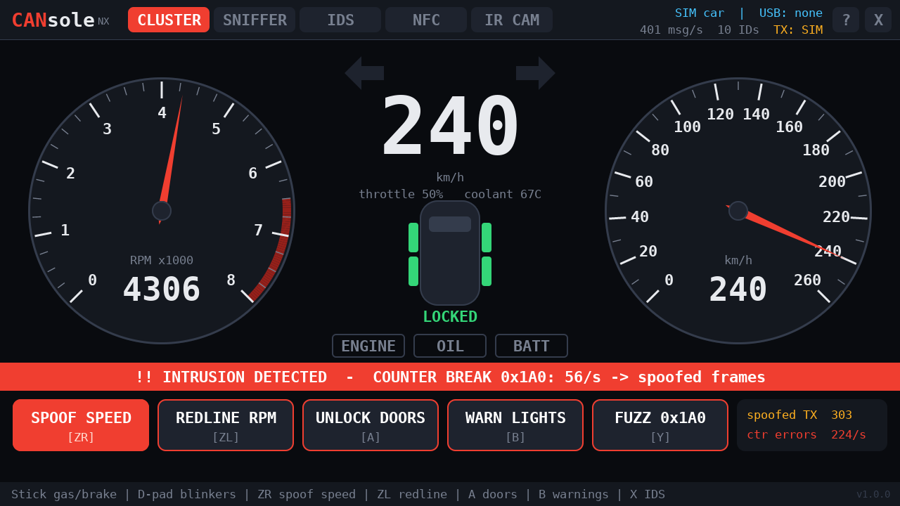

# CANsole NX: car hacking on a Nintendo Switch

A native Switch homebrew app (`.nro`) that turns the console into a CAN bus attack-and-defense console. It needs no Linux and no laptop.



| Tab | What it does |
|---|---|
| **CLUSTER** | Gauge cluster for a virtual car. Drive with the stick, then attack it: spoof the speed (ZR), redline (ZL), unlock the doors (A), turn on the warning lights (B), fuzz (Y). Visitors can use the touch buttons. |
| **SNIFFER** | A cansniffer-style view. Changing bytes flash red and there's a per-bit flip view. Pin any byte to a big auto-scaled gauge, which is how you reverse-engineer an unknown signal. |
| **IDS** | Intrusion detection that learns each ID's normal rate and checks the speed frame's rolling counter. Every attack above gets caught. |
| **NFC** *(experimental)* | The right Joy-Con's NFC reader shows the UID, protocol and chip type of badges, cards and amiibo. Read-only. |
| **IR CAM** *(experimental)* | Live feed from the Joy-Con IR camera with a thermal colour map. It can see TV remotes, Face ID emitters and the IR LEDs on CCTV cameras. |

### Attack → detect → defend, in 3 acts (virtual car)
- **L1 naive replay**: caught by the counter check and the rate IDS.
- **L2 forged counter + checksum**: the payload checks pass, but the rate doubles and gets caught.
- **L3 bus-off masquerade**: the real ECU is silenced and the attacker matches rate, counter and checksum. The IDS shows nothing.
- **SecOC ON**: the receiver verifies a truncated SipHash-2-4 MAC and rejects every forgery (spoofing stopped; denial of service remains).

D-pad **Up** cycles the attack level and **Down** toggles SecOC. Idle for 45 s and the app plays this story by itself.

### RAMN mode (Toyota's RAMN testbed)
The app auto-detects RAMN from its signal IDs, using names and encodings from the RAMN firmware: brake 0x024, accel 0x039, steering 0x062, gear 0x077, lights 0x150, turn 0x1A7, key 0x1B8, LEDs 0x1BB, park brake 0x1D3.
- **Framing-aware sniffer:** `[signal 16b BE][freshness counter 16b BE][CRC32 LE]`. Each CRC is verified live.
- **Dashboard:** steering wheel, pedals, gear, key, light switch, and a mirror of ECU D's own LED report.
- **Armed attacks:** forged hazards, check engine, high beam and park brake. Each forged frame continues the real counter and carries a valid CRC32, and the IDS flags the counter collisions.

### ECU tab (real RAMN)
- **UDS over ISO-TP** to ECU B/C/D (0x7E1–0x7E3): TesterPresent, ReadDataByIdentifier (VIN F190, build date F184) with multi-frame flow control, and ECUReset.
- **ECU power control** through RAMN's USB commands (`yB0`/`yB1`… and `Y1` to restore all).
- **Joy-Con takeover:** powers off ECU B + C, then impersonates all 8 of their messages at their real periods, with continued counters and valid CRC32. The sticks become steering and pedals, and the IDS stays silent.

### Real car bus over USB-C (RAMN / CANable)
Plug in a USB-CAN adapter: **slcan** over USB serial (RAMN, or a CANable with slcan firmware), or **gs_usb/candleLight** (1d50:606f) as a fallback. The app switches to the real bus automatically. It starts at 500 kbit/s and, if the bus stays silent, cycles 1M/250k/125k/800k/100k in listen-only mode until frames appear. If the stream stops, the app re-opens the channel.
- It starts **read-only**: the adapter is opened in slcan **listen-only** (`L`). Hold **+** for 2 seconds to arm TX, which reopens it in normal mode (`O`). Only do this on a bus you own or have permission to test.
- **Safe mode:** hold **ZL** while launching to disable USB, NFC and IR. A boot log is written to `sdmc:/switch/cansole-nx/boot.log`.
- See **[DEMO.md](DEMO.md)** for the full demo script.
- Unplug the adapter and it goes back to the virtual car.

## Install (phone only, no PC)
1. On your phone, download `cansole-nx.nro` from **[Releases → latest](../../releases/latest)**.
2. Copy it to the SD card at `/switch/cansole-nx/cansole-nx.nro`. Either:
   - **Over Wi-Fi:** run **ftpd** on the Switch (from the Homebrew App Store) and upload from a phone FTP app to the address ftpd shows.
   - **With a USB-C SD card reader** on the phone.
3. Open the Homebrew Menu. For full RAM, **hold R while launching a game**; album mode also works. Start **CANsole NX**.

## Controls
| Button | Action |
|---|---|
| L / R | switch tab |
| Left stick | gas / brake (virtual car) |
| ZR (hold) | spoof speed, or override the pinned signal to MAX (real bus, armed) |
| ZL (hold) | spoof RPM, or override the pinned signal to MIN |
| A | unlock doors, or pin a byte to a gauge (sniffer) |
| B | warning lights, or clear pins / alerts / history |
| X | IDS on/off (re-learns the baseline) |
| Y | fuzz the selected ID for 2 s, or thermal/gray view (IR) |
| D-pad | blinkers, or select ID / byte (sniffer) |
| + (hold 2 s) | arm or disarm TX on a real bus |
| L-stick click | candump log to `sdmc:/switch/cansole-nx/` |
| − | help · **− and +** quit |

The touchscreen works for tabs, attack buttons and sniffer rows. After 45 s idle the app runs a **self-playing demo**.

## Build
GitHub Actions builds every push inside `devkitpro/devkita64` (see `.github/workflows/build.yml`). To build locally with devkitPro installed, run `make`.

`host/host_main.c` compiles the platform-independent core with plain gcc against stub devices (fake RAMN, NFC tag, IR image) and renders screenshots. That's how the UI is tested without a Switch:
```bash
gcc -O2 -o cansole_host host/host_main.c source/app.c source/gfx.c source/slcan.c source/font_data.c -lm && OUT=/tmp ./cansole_host
```

`linux/` holds the Python version for Switchroot L4T Ubuntu or any laptop. It supports SocketCAN too.

## Fake car signals
| ID | Signal | Rate |
|---|---|---|
| 0x0B4 | wheel speeds (4× uint16, km/h×100) | 50 Hz |
| 0x120 | engine: RPM uint16, throttle %, coolant+40 | 50 Hz |
| 0x188 | blinkers (bit0 left, bit1 right) | 10 Hz |
| 0x1A0 | speed uint16 km/h×100, counter, checksum | 50 Hz |
| 0x2C1 | steering | 50 Hz |
| 0x2F0 | warnings (engine/oil/battery) | 5 Hz |
| 0x394 | body counter | 10 Hz |
| 0x3E0 | door locks (bits 0–3) | 2 Hz |
| 0x4F0 | ident "CANSOLE1" | 1 Hz |
| 0x5A8 | battery | 5 Hz |

Built for the Hardwear.io NL 2026 Car Hacking Village. Font: DejaVu Sans Mono (Bitstream Vera license).
